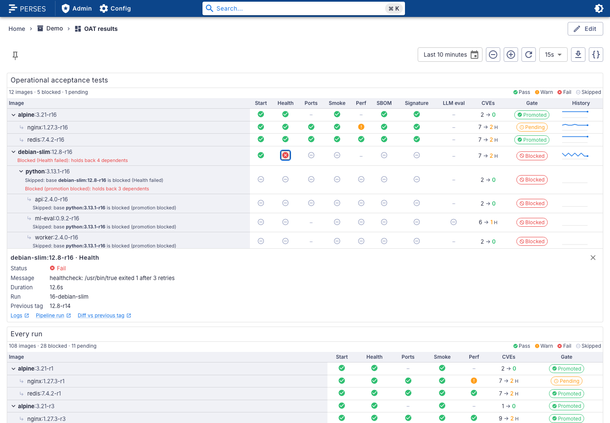

# perses-plugin-oat-results

A [Perses](https://perses.dev) panel plugin, `OATResultsChart`, for the operational acceptance tests
(OAT) of a CVE patching pipeline. Each rebuilt image is a row, under the base image it is built on;
each check (start, health, ports, smoke, perf, SBOM, signature, ...) is a column. One look tells which
image is blocked, by which check, which dependents were skipped because of it, and how many CVEs the
rebuild closed.

<picture>
  <source media="(prefers-color-scheme: dark)" srcset="docs/images/overview-dark.png">
  
</picture>

```promql
{__name__=~"oat_.+|image_cve_total"}
```

## Supported versions

| Plugin | Perses  | Status              |
| ------ | ------- | ------------------- |
| 0.1.x  | v0.55.x | Tested with v0.55.1 |

The plugin is built against `@perses-dev/*` 0.55.1 and `percli` v0.55.1. Other Perses minor versions
may work but are not tested.

## What it does

- **Tree of images.** Rows nest under their base image from `oat_image_info{base_image, base_tag}`,
  to any depth (`debian-slim`, then `python`, then `api`). Images with dependents are bold and can be
  collapsed.
- **A column per check**, each cell an icon with its own shape and colour: pass, warn, fail,
  skipped. A legend explains them, and every cell has an accessible name and a tooltip, so status is
  never shown by colour alone.
- **Why skipped.** A blocked image says what blocked it and how many dependents it holds back
  ("Blocked (Health failed): holds back 4 dependents"); a dependent names the blocked base
  ("Skipped: base debian-slim:12.8-r2 is blocked (Health failed)").
- **CVEs** before → after the rebuild, summed over `severityFilter` (critical and high by default),
  the after count coloured by its worst severity and marked with its initial.
- **Promotion gate** chip: promoted, pending or blocked.
- **Detail strip.** Click a cell (or Tab to it and press Enter) for the check's status, message,
  duration, run id, base image, previous tag and links to logs, the pipeline run and a diff.
- **History.** An optional sparkline per row with the pass rate of the image's last runs.
- One row per image (its latest run), or one row per run.
- Light and dark themes follow Perses; colours come from the theme.

200 images with 10 checks each render in about half a second and stay responsive: the data
transform is memoised and rows only re-render when they change.

## Data

The panel reads time series that follow the contract in [docs/metrics.md](docs/metrics.md):

| Metric                       | Value                                |
| ---------------------------- | ------------------------------------ |
| `oat_check_result`           | 1 pass, 0.5 warn, 0 fail, -1 skipped |
| `oat_image_info`             | 1; labels give the base image        |
| `oat_check_duration_seconds` | seconds                              |
| `oat_check_info`             | 1; `message` label                   |
| `image_cve_total`            | count per `severity` and `phase`     |
| `oat_promotion_status`       | 1 promoted, 0.5 pending, 0 blocked   |
| `oat_run_timestamp_seconds`  | when the run started                 |

The panel tells metrics apart by name, so keep `__name__` in the query; the selector above is
enough. `dev/oat-push.sh` is a reference pusher for a Pushgateway (POSIX sh and curl), and
`docs/metrics.md` has GitHub Actions and Tekton examples.

## Options

| Option                   | Default            | Meaning                                           |
| ------------------------ | ------------------ | ------------------------------------------------- |
| `checks`                 | from the data      | the check columns, in order                       |
| `checkLabels`            | built-in names     | column titles, `{ llm_eval: "LLM eval" }`         |
| `severityFilter`         | `[critical, high]` | severities summed in the CVE column               |
| `linkTemplates`          | none               | `logs`, `pipelineRun`, `diff` URLs                |
| `showOnlyLatestPerImage` | `true`             | one row per image; `false` shows every run        |
| `showHistory`            | `false`            | the history sparkline                             |
| `historyRuns`            | `10`               | runs in the sparkline, 2 to 50                    |
| `durationFormat`         | seconds, 1 decimal | Perses format of the duration in the detail strip |

Link templates take `${image}`, `${tag}`, `${run_id}`, `${check}`, `${base_image}`, `${base_tag}`,
`${previous_tag}` and `${run_url}`, URL-encoded except `${run_url}`, and dashboard variables. Only
`http(s)` and relative links are shown. Every option has a control in the panel editor.

```yaml
kind: OATResultsChart
spec:
  checks: [start, health, ports, smoke, perf, sbom, signature, llm_eval]
  checkLabels: { llm_eval: LLM eval, sbom: SBOM }
  severityFilter: [critical, high]
  linkTemplates:
    logs: https://logs.example.com/explore?query=%7Brun_id%3D%22${run_id}%22%7D
    pipelineRun: ${run_url}
    diff: https://git.example.com/images/${image}/compare/${previous_tag}...${tag}
  showOnlyLatestPerImage: true
  showHistory: true
  historyRuns: 10
  durationFormat: { unit: seconds, decimalPlaces: 1 }
```

The CUE schema is `schemas/panels/oat-results-chart/oat-results-chart.cue`, with an example next to
it and valid and invalid cases under `tests/`.

## Try it locally

`dev/` runs Perses with the plugin, Prometheus, a Pushgateway and a fake pipeline that rebuilds
twelve images every 30 seconds through `dev/oat-push.sh`: a base whose health check usually fails
(so its dependents are skipped), warnings, pending gates and CVE counts. The screenshot above comes
from it. It needs `podman compose` or `docker compose`.

```bash
npm ci && npm run build && percli plugin build
cp OATResults-*.tar.gz dev/archive/
podman compose -f dev/docker-compose.yaml up -d    # PERSES_PORT=18080 to move it off 8080
```

Open <http://localhost:8080/projects/demo/dashboards/oat-results>. The first run shows up within a
minute, the history after a few. `podman compose -f dev/docker-compose.yaml down` removes it again.

## Build

```bash
npm ci
npm test               # Jest and React Testing Library
npm run build          # module-federation bundle in dist/
percli plugin build    # writes OATResults-<version>.tar.gz
```

See `CONTRIBUTING.md` for the checks and the release process, and `docs/DECISIONS.md` for the design
choices.

## Install into Perses

Perses extracts every `*.tar.gz` in `plugin.archive_paths` into `plugin.path` at startup. Setting
`archive_paths` replaces the default, so keep the directory of bundled plugins in the list. Pick one
of the three options below and restart Perses.

### Option A: release archive

Download `OATResults-<version>.tar.gz` from the
[GitHub releases](https://github.com/astrona-io/perses-plugin-oat-results/releases), put it in a
directory Perses can read, and add that directory to the config:

```bash
curl -fLO https://github.com/astrona-io/perses-plugin-oat-results/releases/download/v0.1.0/OATResults-0.1.0.tar.gz
```

```yaml
plugin:
  archive_paths:
    - /etc/perses/plugins-archive # plugins bundled with Perses
    - /etc/perses/plugins-archive-extra # put OATResults-0.1.0.tar.gz here
```

### Option B: Kubernetes image volume

The `Containerfile` packages the archive as a plugin-only OCI image (`FROM scratch`, the archive at
the image root). Every release publishes it as `ghcr.io/astrona-io/perses-plugin-oat-results:v<version>`
for linux/amd64 and linux/arm64, so you can use that image directly. To build and push it to your own
registry instead:

```bash
percli plugin build
podman build -t ghcr.io/<owner>/perses-plugin-oat-results:<version> .
podman push ghcr.io/<owner>/perses-plugin-oat-results:<version>
```

Then mount it into the Perses pod as an
[image volume](https://kubernetes.io/docs/concepts/storage/volumes/#image) and add the mount path to
`archive_paths` as in option A. Image volumes need a cluster and container runtime that support them
(the `ImageVolume` feature; check your Kubernetes version and feature gates).

```yaml
volumes:
  - name: oat-results-plugin
    image:
      reference: ghcr.io/<owner>/perses-plugin-oat-results:<version>
      pullPolicy: IfNotPresent
containers:
  - name: perses
    volumeMounts:
      - name: oat-results-plugin
        mountPath: /etc/perses/plugins-archive-extra
        readOnly: true
```

If the registry is private, add an `imagePullSecrets` entry to the pod as for any other image.

### Option C: custom Perses image

Copy the archive into the directory of bundled plugins. No config change is needed, because that
directory is in the default `archive_paths`:

```dockerfile
FROM persesdev/perses:v0.55.1
COPY OATResults-0.1.0.tar.gz /etc/perses/plugins-archive/
```

## Licences and credits

The plugin is Apache-2.0 (`LICENSE`). Third-party material and its notices are listed in `NOTICE`:
the Perses shared CUE schemas, vendored into the archive at build time (Apache-2.0).
